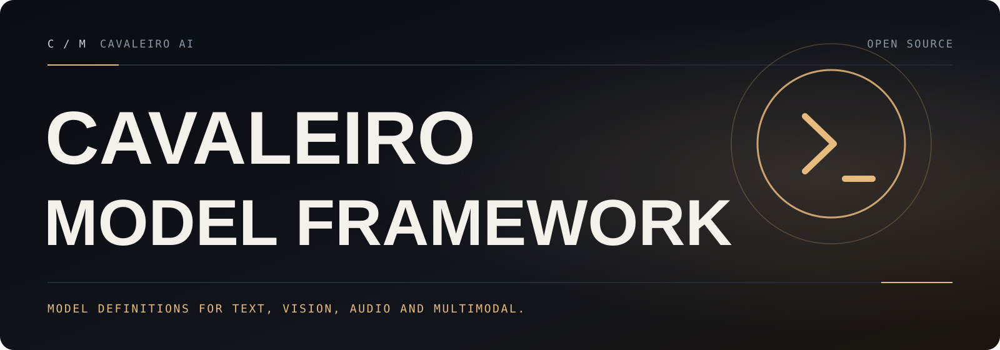

**English** · [Português (Brasil)](README.pt-BR.md)

<!---
Copyright 2020 The HuggingFace Team. All rights reserved.
Modified by Cavaleiro AI (2026): rewritten as the Cavaleiro Model Framework README.

Licensed under the Apache License, Version 2.0 (the "License");
you may not use this file except in compliance with the License.
You may obtain a copy of the License at

    http://www.apache.org/licenses/LICENSE-2.0

Unless required by applicable law or agreed to in writing, software
distributed under the License is distributed on an "AS IS" BASIS,
WITHOUT WARRANTIES OR CONDITIONS OF ANY KIND, either express or implied.
See the License for the specific language governing permissions and
limitations under the License.
-->

<a id="top"></a>

<p align="center">
  
</p>

# Cavaleiro Model Framework

<p align="center">
  <a href="https://github.com/cavaleiro-ai/cavaleiro-model-framework/actions/workflows/cavaleiro-ci.yml"></a>
  <a href="LICENSE"></a>
  <a href="CHANGELOG.md"></a>
</p>

**The model-definition framework for text, vision, audio, video, and multimodal models — with verified robustness and Windows fixes.**

Cavaleiro Model Framework provides the complete library — hundreds of model architectures, the `pipeline` API, `generate`, tokenizers and processors, the `Trainer`, the `transformers` CLI — with fixes for bugs in core, model-agnostic code: generation, pipelines, Hub uploads, argument parsing, and the developer CLI. Each fix has a regression test that fails on the base commit and passes here.

It is a drop-in replacement: you still `import transformers`, models still load from the [Hugging Face Hub](https://huggingface.co/models), and your existing code and checkpoints keep working.

## What Cavaleiro Model Framework adds

Everything in the original project at commit `d4804f9`, plus ([full changelog](CHANGELOG.md)):

- **Generation that no longer crashes on `encoder_outputs`:** `encoder_repetition_penalty` and `encoder_no_repeat_ngram_size` are skipped with a warning, instead of crashing or silently using placeholder ids, when you pass precomputed encoder outputs.
- **Safer `pipeline()` arguments:** `code_revision` works from `model_kwargs` or as a keyword and reaches the model load, and `pipeline()` no longer writes into the `model_kwargs` dictionary you pass, so it can be reused.
- **Correct `push_to_hub` names and paths:** the default repository name works with `pathlib.Path`, trailing separators, and forward slashes on Windows, in all ten `save_pretrained` implementations; files from sub-folders are uploaded with `/` paths on Windows.
- **Windows fixes:** `HfArgumentParser` reads `.args` files as UTF-8; `transformers add-new-model-like` runs its helper scripts with the current interpreter, so it works from a virtual environment that is not activated.
- **Backward compatibility restored:** `AutoVideoProcessor.register(config, processor, True)` accepts the legacy positional `exist_ok` again.
- **Fork-safe CI and docs:** a [Cavaleiro CI](.github/workflows/cavaleiro-ci.yml) workflow that needs only a read-only token, the original project's publishing and GPU workflows [disabled with re-enable instructions](.github/workflows-disabled/README.md), [engineering notes](docs/cavaleiro/ENGINEERING.md) with the architecture map and test evidence, and a [complete guide in Portuguese](docs/cavaleiro/GUIA-PT-BR.md).

## Installation

Cavaleiro Model Framework works with Python 3.10 to 3.14 and [PyTorch](https://pytorch.org/get-started/locally/) 2.6 or newer. It is distributed as source: it is not published on PyPI, and `pip install transformers` installs the original project from PyPI instead.

Clone the repository and install it in a virtual environment. With [uv](https://docs.astral.sh/uv/):

```shell
git clone https://github.com/cavaleiro-ai/cavaleiro-model-framework.git
cd cavaleiro-model-framework
uv venv --python 3.12 .venv
# Linux and macOS
source .venv/bin/activate
# Windows (PowerShell)
.venv\Scripts\Activate.ps1

uv pip install -e ".[torch]"
```

Or with the standard library `venv` and `pip`:

```shell
python -m venv .venv
# activate it as above, then:
pip install -e ".[torch]"
```

For a CPU-only PyTorch on Linux, install PyTorch first from its CPU index: `pip install torch --index-url https://download.pytorch.org/whl/cpu`. The PyTorch wheels on PyPI for Windows and macOS are CPU (or Apple Silicon) builds already. To check the installation, run `transformers env`.

Other extras are defined in [`setup.py`](setup.py), for example `".[torch,vision,sentencepiece]"`, or `".[testing]"` for development.

## Quickstart

The [`pipeline`](docs/source/en/pipeline_tutorial.md) API is the fastest way to run a model. It downloads and caches the model, preprocesses the input, and returns readable output:

```py
from transformers import pipeline

pipe = pipeline(task="text-generation", model="Qwen/Qwen2.5-0.5B-Instruct")
pipe("The secret to baking a really good cake is ", max_new_tokens=40)
```

Chat with a model by passing a list of messages:

```py
import torch
from transformers import pipeline

chat = [
    {"role": "system", "content": "You are a concise assistant."},
    {"role": "user", "content": "Give me three ideas for a weekend in São Paulo."},
]
pipe = pipeline(task="text-generation", model="Qwen/Qwen2.5-0.5B-Instruct", dtype=torch.bfloat16, device_map="auto")
response = pipe(chat, max_new_tokens=256)
print(response[0]["generated_text"][-1]["content"])
```

You can also chat from the terminal while [`transformers serve`](docs/source/en/serve-cli/serving.md) is running: `transformers chat Qwen/Qwen2.5-0.5B-Instruct`.

<details>
<summary>Automatic speech recognition</summary>

```py
from transformers import pipeline

pipe = pipeline(task="automatic-speech-recognition", model="openai/whisper-large-v3")
pipe("https://huggingface.co/datasets/Narsil/asr_dummy/resolve/main/mlk.flac")
# {'text': ' I have a dream that one day this nation will rise up and live out the true meaning of its creed.'}
```

</details>

<details>
<summary>Image classification</summary>

```py
from transformers import pipeline

pipe = pipeline(task="image-classification", model="facebook/dinov2-small-imagenet1k-1-layer")
pipe("https://huggingface.co/datasets/Narsil/image_dummy/raw/main/parrots.png")
# [{'label': 'macaw', 'score': 0.997...}, ...]
```

</details>

<details>
<summary>Visual question answering</summary>

```py
from transformers import pipeline

pipe = pipeline(task="visual-question-answering", model="Salesforce/blip-vqa-base")
pipe(
    image="https://huggingface.co/datasets/huggingface/documentation-images/resolve/main/transformers/tasks/idefics-few-shot.jpg",
    question="What is in the image?",
)
# [{'answer': 'statue of liberty'}]
```

</details>

Lower-level use is unchanged: `AutoTokenizer`, `AutoModelFor...`, `model.generate(...)`, `Trainer`. The [library documentation](docs/source/en/index.md) applies to Cavaleiro Model Framework as is; the [Portuguese guide](docs/cavaleiro/GUIA-PT-BR.md) has more examples.

## Compatibility

Cavaleiro Model Framework changes the project identity, not the identifiers your code depends on:

- The Python package is still **`transformers`**: `import transformers`, `from transformers import AutoModel`, and every import path are unchanged. Its version string is the development version of the original project that this release is based on (`5.21.0.dev0`).
- The command-line tool is still **`transformers`** (`transformers env`, `transformers chat`, `transformers serve`, `transformers download`, `transformers add-new-model-like`).
- Environment variables (`HF_HOME`, `HF_HUB_OFFLINE`, `HF_TOKEN`, `TRANSFORMERS_VERBOSITY`, ...), cache locations, configuration file names (`config.json`, `generation_config.json`, `tokenizer_config.json`, ...), and checkpoint formats are unchanged. Models saved with Cavaleiro Model Framework load in the original project and vice versa.
- Models, tokenizers, and datasets still come from the Hugging Face Hub (`huggingface.co`), through `huggingface_hub`, as in the original project.
- Because both distributions are named `transformers`, install only one of them per environment.
- **Telemetry, unchanged from the original project:** requests to the Hub send a user agent with the library, Python, and PyTorch versions, a random session id, and usage context (for example whether a pipeline or an auto class was used). Set `HF_HUB_DISABLE_TELEMETRY=1` to send only the versions and `telemetry/off`, or `HF_HUB_OFFLINE=1` to make no Hub requests at all.

### Notes for Windows

- The Hugging Face Hub cache uses symbolic links. Without Developer Mode (or administrator rights) it falls back to copying files and prints a warning; enable Developer Mode to save disk space.
- `torch.compile` needs the Microsoft C++ compiler (`cl.exe`, from the Visual Studio Build Tools) on `PATH`. Without it, code paths that compile fail with `InvalidCxxCompiler`; everything else runs.
- Set `PYTHONUTF8=1` if your own scripts read text files without an explicit encoding.

## Contributing

Bug reports, fixes, and documentation improvements are welcome. Read the [contributing guide](CONTRIBUTING.md) for the development setup and the targeted test commands, and report vulnerabilities privately as described in the [security policy](SECURITY.md). New model architectures and documentation translations are out of scope for this repository.

[Contributing guide](CONTRIBUTING.md) · [Security policy](SECURITY.md) · [Code of Conduct](CODE_OF_CONDUCT.md) · [Changelog](CHANGELOG.md) · [Engineering notes](docs/cavaleiro/ENGINEERING.md) · [Translated READMEs](docs/original-i18n/README.md)

## License

Based on Transformers · Apache License 2.0 · see [LICENSE](LICENSE) and [NOTICE](NOTICE). Not affiliated with the original project.

<p align="center"><a href="#top">Back to top ↑</a></p>
